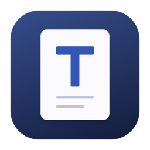

# Textly

Textly is a native macOS notepad and text editor, built for clear writing and dependable daily editing.

This is the **official Textly download and support repository**, maintained by hydakyo. It contains distribution assets and product information. Application source is not included.

## Download

**[Download Textly for macOS](https://github.com/hydakyo/Textly/releases/latest)**

Requires **macOS 15 or later**. The Universal app contains **Apple Silicon and Intel** executables. Runtime validation is performed on Apple Silicon; Intel hardware testing remains unverified.

## Install and update

1. Download the DMG from Releases and open it.
2. Drag Textly into Applications, eject the disk image, then open Textly from Applications. A ZIP is also available.
3. This team distribution is ad hoc signed and is not Apple-notarized. If macOS blocks first launch, use System Settings → Privacy & Security → Open Anyway after verifying the download came from this repository. Managed Macs may require IT approval.
4. Before updating, quit Textly with ⌘Q, then replace the app in Applications. Keep the Textly Application Support folder to retain drafts.

Every release includes SHA-256 checksums and a build manifest. Put the ZIP, DMG, manifest and checksum file in one folder and run `shasum -a 256 -c SHA256SUMS.txt` to verify them.

## Everyday editing

- Native toolbar, document tabs, sidebar, and light/dark appearances.
- Plain-text editing, line numbers, word wrap, font and size preferences.
- Unicode and Vietnamese text handling; undo/redo remains available after switching tabs or closing and reopening the window.
- Find/Replace with case, whole-word and regular-expression options.
- UTF-8, UTF-16, Windows-1252 and Latin-1 support; LF, CRLF and CR line endings.
- Local draft recovery, atomic saves, and detection of external file changes.
- Open from Finder or drag and drop. Setting Textly as the default editor is optional.

⌘N New · ⌘O Open · ⌘S Save · ⌘F Find · ⌘, Settings · ⌘Q Quit.

The red close button closes the window and keeps Textly running. Click its Dock icon to return to the same workspace.

## Local data and limits

No account or network connection is needed to edit documents. Drafts are stored locally, as unencrypted text, in `~/Library/Application Support/Textly/session.json`; source files are written only when you choose Save. Diagnostic tools run locally and do not automatically upload your documents.

Files up to 32 MB are supported. Syntax/folding is disabled for large documents to keep editing responsive. There is no plugin API or LSP service.

## Support

[Report a problem](https://github.com/hydakyo/Textly/issues) with your macOS version, chip type, Textly version, steps and a sample with private content removed. See [release history](CHANGELOG.md) and [data handling](PRIVACY.md).
